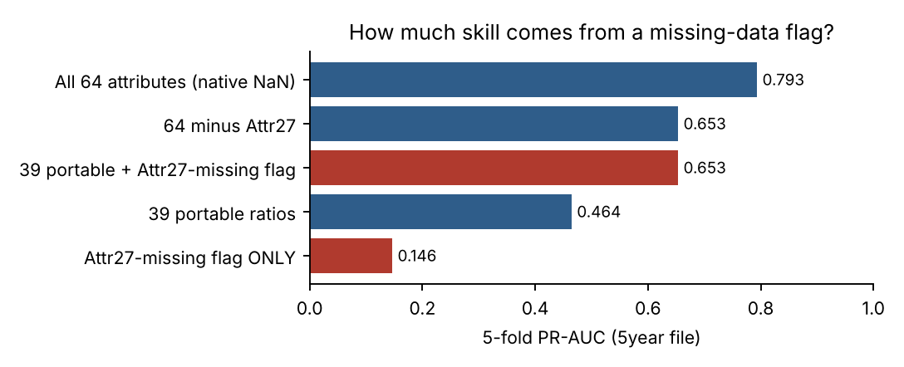
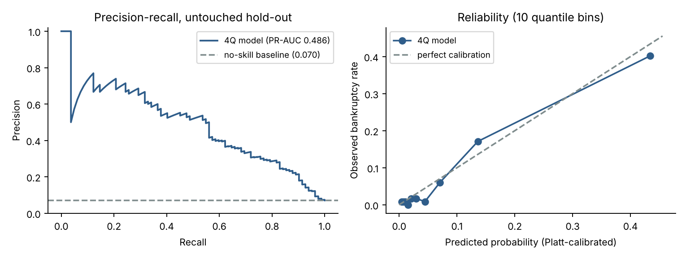
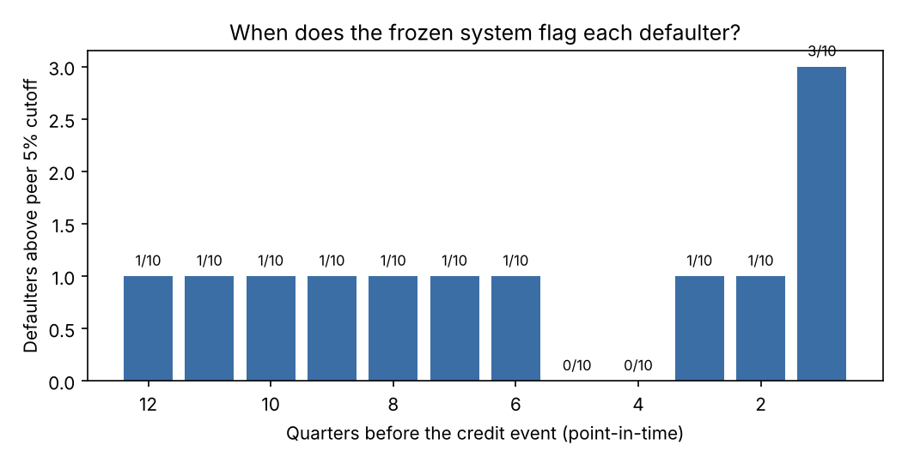
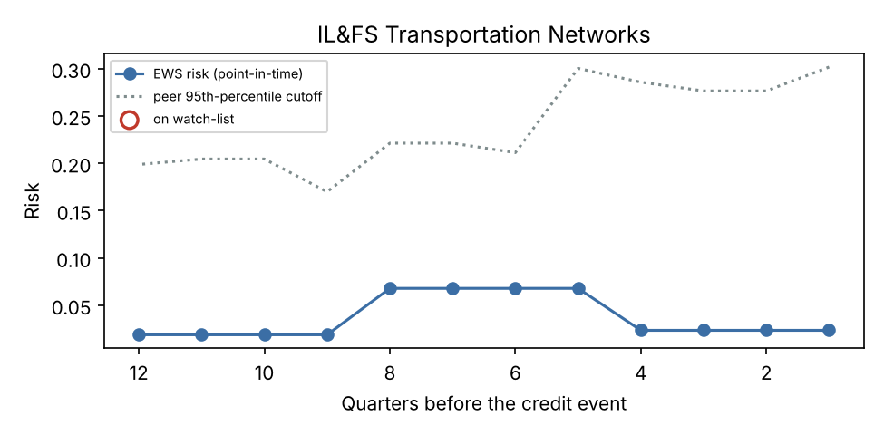
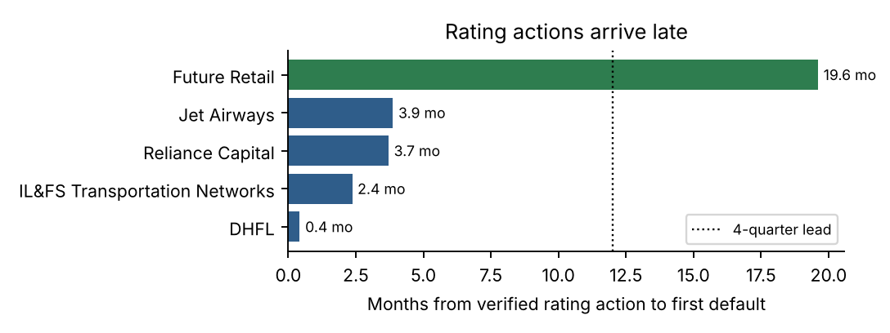
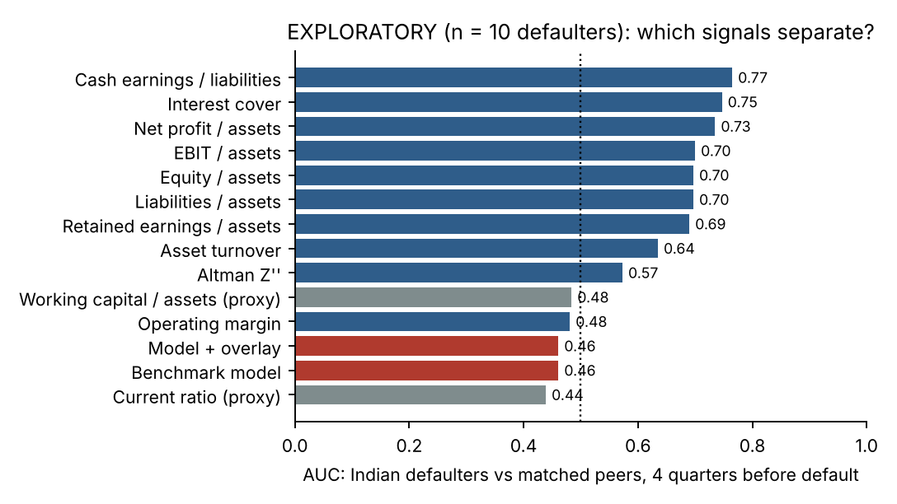
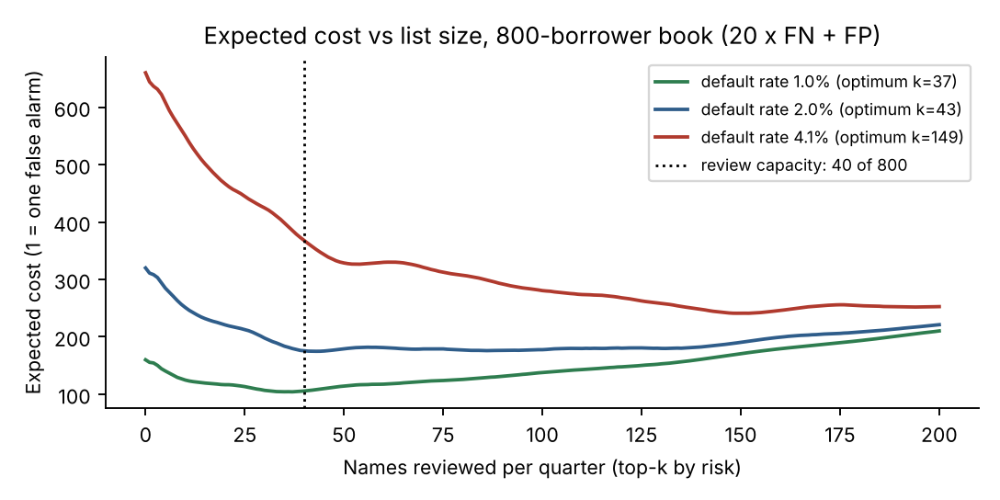

# Summary

CreditWatch produces a **quarterly watch-list of the 40 riskiest names in an 800-borrower book** (the 5% review budget). Each name carries three plain-language drivers, Altman Z'' / Beneish M / Piotroski F screens, dated soft signals and a review memo. Every input is point-in-time: a number enters only after the date it became public.

| Question the judges asked | Our answer | Evidence |
|---|---|---|
| Does the distress model work on the benchmark? | Yes. 4-quarter model PR-AUC **0.486** vs 0.070 baseline (6.9x); 8-quarter model **0.395** vs 0.053 (7.4x), untouched hold-out | §2 |
| Could it have flagged the Indian cases in time? | **Mostly no, and we say so.** Pre-registered test, 10 defaulters vs 31 peers: model alone caught **2/10** four quarters ahead, the full overlay **0/10**, and **0/10** eight quarters ahead | §3 |
| Why not, and what would work? | Standalone, condensed statements hide group stress and make the working-capital proxy noisy; rating actions arrive 2 weeks to 4 months before default. Simple debt-service ratios *do* separate defaulters 4 quarters ahead (AUC 0.70 to 0.77, exploratory) | §3.4 |
| Is the 5% budget respected? | Always: hard cap of 40, overflow list, stress trigger | §6 |
| Does the threshold minimise cost? | p* = 1/21 on calibrated probabilities; at a 2% default rate the cost-optimal list is 43 names, so the 40-name cap costs 0.5%; at 4.1% it costs +52% | §6 |
| Could you have tuned on the answers? | No. Models, weights and rules were frozen and committed (SHA-256) before any Indian case was scored; evaluation refuses to run on edited settings | §3.2 |

The negative Indian result is the most useful finding in this submission. A benchmark-trained model that looks good on paper (PR-AUC 6.9x the baseline) did not transfer to Indian filings, and we show exactly why.

# 1. System overview

```
filings (dated) --> 39 portable ratios --> lead-matched LightGBM (imputed, calibrated) --> p
Z''/M/F screens + interest cover < 1 ------------------------------------------> overlay
dated soft signals (rating, pledge, auditor, filing delay, related party) -----> overlay
p + overlay --> risk --> rank --> top 40 of 800 + memos  (rank 41+ above p*: overflow list)
```

- `src/model.py`: benchmark training, calibration, hold-out metrics, ablation, model comparison
- `src/indian.py`: point-in-time panel, leakage guard, pre-registered evaluation
- `src/rank.py`: overlay, SHAP drivers, memos, budget simulation
- `src/config.py`: pre-registration freeze and verify
- `src/api.py` + `frontend/`: FastAPI + React app (7 pages); `app.py`: Streamlit; `score_any.py`: score any statements file
- `python run_all.py` rebuilds every number in this report; `python -m pytest -q` runs 40 unit and integration tests.

# 2. D1: benchmark distress model

**Data.** UCI Polish Companies Bankruptcy, all five horizon files (43,405 firm-years, 2,091 bankrupt; counts match UCI). File *k* holds ratios observed (6 − *k*) years before the label.

**Lead-matched design.** The Indian test asks about 4- and 8-quarter lead, so the 4Q model is trained on the **5year file** (bankrupt within 1 year) and the 8Q model on the **4year file** (within 2 years). The benchmark target therefore matches the test target.

**Features.** 39 ratios that can be rebuilt from an Indian balance sheet and P&L, mapped one-to-one to UCI attributes (`src/features.py`). There are no absolute amounts (currency- and era-dependent).

**Leakage controls.** Exact duplicates are removed before the split (60 rows in the 5year file). A stratified 20% hold-out is carved first and used once. Imputer, Platt calibrator and cost threshold are fitted on development folds only.

**The missing-data artefact.** In the UCI data, missing values cluster in bankrupt firms. Attr27 (operating profit / financial expenses) is missing for 390 firms; 31.5% of them went bankrupt vs 5.2% otherwise, and that *missingness flag alone* reaches PR-AUC 0.146. A native-NaN 64-attribute model scores 0.833, partly by reading "missing" as "bankrupt". That cannot transfer: a debt-free Indian company has no interest cost. Our production models drop Attr27 and **median-impute every other ratio inside the training folds**, so missingness carries no signal. This costs almost nothing (5-fold PR-AUC 0.429 imputed vs 0.432 native-NaN).

{width=85%}

**Model selection** (identical 5-fold CV on the 4Q development set, PR-AUC): logistic 0.321, random forest 0.375, XGBoost 0.438, LightGBM native-NaN 0.432, **LightGBM median-imputed 0.429 (selected for transferability)**.

**Hold-out results.**

| | 4Q model (5year file) | 8Q model (4year file) |
|---|---|---|
| Hold-out size (bankrupt) | 1,170 (82) | 1,942 (103) |
| PR-AUC [95% bootstrap CI] | **0.486** [0.376, 0.609] | **0.395** [0.310, 0.479] |
| No-skill baseline / lift | 0.070 / 6.9x | 0.053 / 7.4x |
| ROC-AUC | 0.890 | 0.846 |
| Brier score (calibrated) | 0.047 | 0.040 |
| Top 5% of hold-out: precision / recall | 54% / 39% | 37% / 35% |
| At p* = 1/21: recall / alert rate | 90% / 33% | 76% / 29% |



*Caveat:* the dataset has no calendar dates or firm IDs, so the hold-out is out-of-sample in firms, not in time. Treat these figures as an upper bound.

# 3. D2: Indian case test

## 3.1 Panel

**Ten listed defaulters.** The event date is the **earliest documented credit event**, each with a source: an exchange filing, rating-agency release, trustee notice or NCLT order (`data/indian/events.csv`).

| Defaulter | Event date | Event | Later milestone (not used) |
|---|---|---|---|
| Jet Airways | 31 Dec 2018 | missed interest + principal to SBI consortium | grounding Apr 2019, CIRP Jun 2019 |
| DHFL | 4 Jun 2019 | delayed NCD obligations; CP cut to D | RBI supersession Nov 2019 |
| Reliance Capital | 9 Sep 2019 | NCD coupon paid late; CARE D | RBI supersession Nov 2021 |
| Future Retail | 31 Dec 2021 | missed Rs 3,494.56 cr principal | CIRP Jul 2022 |
| Coffee Day Enterprises | 11 Sep 2019 | ICRA BB+ → D (group delays Aug 2019) | founder's death 31 Jul 2019 is not a credit event |
| Alok Industries | 18 Jul 2017 | NCLT admits SBI petition | earlier defaults not verified |
| Bhushan Steel | 1 Apr 2015 | debenture interest default (trustee notice) | CIRP Jul 2017 |
| Reliance Communications | 30 May 2017 | CARE and ICRA cut to D | NCLT May 2018 |
| Sintex Industries | 31 May 2019 | bank-facility delays; NCD default 11 Jun; CARE D | CIRP Apr 2021 |
| IL&FS Transportation Networks | 28 Sep 2018 | CARE BB → D | the parent IL&FS Ltd was unlisted, so its listed road subsidiary is used |

Using the later milestones would have inflated lead time by 3 to 28 months.

**31 matched peers.** Same sector, listed on the event date, no default found through event + 8 quarters. One peer was dropped because it listed after its event.

**Financials.** Screener.in standalone statements, 484 company-years. The four defaulters added in our audit are transcribed in `data/indian/screener_raw/`, and every balance sheet adds up (tested). Current assets and liabilities are Screener's condensed "other assets / other liabilities" (a flagged proxy). Unknown items stay missing, never 0. Alok's two 18-month periods are annualised.

**Point-in-time rules.** Observation = event − 3*L* months. A fiscal year counts only once FY end + 120 days has passed; SEBI LODR requires audited results within 60 days, so this is conservative. Soft signals count only if dated before the observation and within the prior 365 days. Peers are observed on their defaulter's date. Four tests check this on the real panel.

## 3.2 Pre-registration

`config/frozen_config.json` pins the model-file SHA-256 hashes, overlay weights, soft-signal rules, lags, lead mapping, cost ratio, capacity and the metric definition. It was **committed before any Indian case was scored** (see the commit history). `indian.evaluate()` verifies the hash and refuses to run if anything differs; this is tested by tampering with a weight. Every change is logged in `docs/DEVIATIONS.md`.

**Primary metric.** Peers stand in for the performing book. Defaulters are about 2% of a real book, so its 95th percentile is the performing firms' 95th percentile. A defaulter is caught if its score is above the 95th percentile of peer scores at the same lead (the 5% budget). We report Wilson 95% intervals.

## 3.3 Result: reported as-is

| Lead | Model only | Model + Z/M/F | Full (+ soft signals) | Soft signals only |
|---|---|---|---|---|
| 4 quarters | **2/10** [6%, 51%] | 0/10 [0%, 28%] | **0/10** [0%, 28%] | 1/10 (Future Retail) |
| 8 quarters | **0/10** | 0/10 | **0/10** | 0/10 |

A secondary method (a simulated 800-name book with a Polish background) also gives 0/10, even though it favours Indian firms. **Post-hoc threshold-free AUC, defaulters vs peers: 0.46 at 4Q and 0.46 at 8Q, no better than chance.** Of the 10 defaulters, 3 cross the cutoff one quarter ahead; only Jet Airways is above it from 6 to 12 quarters ahead.

{width=80%}

## 3.4 Why it failed, and what does work

1. **Group structures hide the stress.** ITNL and Coffee Day were holding or infrastructure companies whose distress sat in group SPVs and subsidiaries. Their standalone "other assets" are mostly loans to group companies, so they look liquid. ITNL's risk never rose above 0.07 against a peer cutoff of 0.17 to 0.30.

   {width=75%}

2. **The condensed-balance-sheet proxy is noise.** On Indian data, WC/TA has AUC 0.48 and the current ratio 0.44. Z'' (which uses WC) puts healthy peers such as Ashoka Buildcon and Shoppers Stop (the latter likely because of Ind AS 116 lease liabilities) in the "distress" zone. That raises the cutoff, which is why the overlay *lowered* recall.
3. **The benchmark model learned non-credit patterns.** SHAP on a synthetic distressed company showed the trees treating costs above sales, negative working capital and negative retained earnings as *safe*. A post-hoc v2 with credit-logic monotone constraints, frozen separately before scoring, did not help: benchmark PR-AUC fell to 0.395 / 0.187 and Indian AUC was 0.37 to 0.43. v1 therefore stays primary and v2 is reported as tested and rejected.
4. **Rating actions are late.** Of the five verified pre-default rating actions, four arrived 2 weeks to 4 months before default. Only Future Retail's came at least 4 quarters ahead.

   {width=75%}

**What does separate Indian defaulters (exploratory; read after the frozen results; n = 10; not used to tune anything).** Classic debt-service ratios, four quarters before default:

{width=80%}

Cash earnings / total liabilities (Beaver's best single predictor) has AUC 0.77, interest cover 0.75 and ROA 0.73; leverage and equity ratios are about 0.70. **The recommended next step** is an India-trained, monotone debt-service scorecard on *consolidated* statements, validated out-of-time (e.g. fit on the 2015–17 defaults, test on 2018–22). The pipeline, leakage guard and freeze mechanism are already in place for it.

# 4. D3: forensic screens and soft signals

- **Altman Z''** (emerging-market version): 6.56 X1 + 3.26 X2 + 6.72 X3 + 1.05 X4. Zones: < 1.10 distress, 1.10–2.60 grey, > 2.60 safe.
- **Beneish M** (8 variables, cutoff −1.78) and **Piotroski F** (9 tests, ≤ 3 weak). All three are checked against hand calculations on a worked example in the tests (Z'' = 2.270, M = −1.741, F = 3).
- Banks and NBFCs (DHFL, Reliance Capital) skip Z/M/F by design. With Screener data, M and F need COGS, SG&A and share counts, so they are reported as missing rather than guessed.
- **Soft signals** (capped log-odds policy priors, not fitted): rating downgrade or watch-negative, promoter pledge > 50%, auditor red flag, delayed filing, related-party stress. The shipped panel uses five rating actions verified with URLs. An earlier unverified list is kept aside and unused.

# 5. D4: explanations

Top-3 SHAP drivers come from the model input, rendered as *ratio → firm value vs healthy-peer median → why it matters*. Two rules keep memos honest. Imputed (missing) ratios are never drivers. A driver is written up only if the firm's value is on the risky side of the median under credit logic, because tree models can attach risk to healthy-looking values. Example: **Jet Airways, four quarters before default** (FY2017 accounts):

> 1. Retained earnings are −52.0% of assets (healthy peers 0.0%); accumulated losses have eroded the equity cushion.
> 2. Long-term funding is 20.5% of assets (healthy peers 63.4%); long assets may be funded with short-term money (ALM risk).
> 3. Sales cover short-term liabilities only 2.14x (healthy peers 5.10x); revenue is small relative to near-term claims.

Each memo adds the Z/M/F values, active soft signals and a recommended action.

# 6. D5: operating policy and cost

**Cost.** A missed default costs 20, a false alarm 1. For a calibrated probability *p*, flagging is worth it when 20*p* > 1 − *p*, i.e. **p > p\* = 1/21 ≈ 4.76%**. Probabilities are prior-shifted to the bank's own default rate before applying p\*.

**Capacity.** Results from 1,000 simulated 800-borrower books per default rate, drawn from the 4Q hold-out:

| Book default rate | Defaulters | Recall in top 40 | Cost at 40 | Cost-optimal list (cost) | Flag nobody | Names above p* |
|---|---|---|---|---|---|---|
| 1.0% | 8 | 56% | 105.7 | 37 (104.2) | 160 | ~39 |
| 2.0% | 16 | 55% | 175.6 | 43 (174.8) | 320 | ~80 |
| 4.1% (CRISIL 2017 all-issuer) | 33 | 48% | 367.7 | 149 (241.1) | 660 | ~161 |

{width=85%}

In a normal book the 40-name cap is essentially cost-optimal (0.5% penalty at 2%). In a stressed book it binds (+52% at 4.1%), but it is still 44% cheaper than no monitoring. More than 40 names above p* is itself a **portfolio-stress trigger**.

**Workflow** (`policy.md`):

1. Day 1: the system issues the ranked list and memos.
2. Days 2–10: analyst triage.
3. By day 30: deep review with the sector head.
4. Next sitting: credit committee. Humans approve every limit change.

Hard triggers escalate immediately: a rating cut to sub-investment grade, a payment delay or an auditor resignation. Names above p* outside the 40 go to an overflow list. Calibration is refreshed quarterly to the realised default rate, and the model is retrained yearly. **Given §3, the model score is advisory for Indian borrowers until an India-trained model is validated.**

# 7. What we fixed in the earlier version (audit)

Our earlier CreditWatch build claimed 60% Indian recall at 4 quarters. The audit found that this number did not hold up, and the commit history shows each fix:

| Issue found | Fix |
|---|---|
| Four defaulters (IL&FS, DHFL, Bhushan, Sintex) had round-number "reconstructed" rows, not filings | Replaced with Screener statements; the old rows are kept for audit and never used |
| Event dates were late milestones (Jet grounding, DHFL RBI supersession) | Earliest documented default, each sourced |
| Production model trained on the 5-year-horizon file and used for 4Q/8Q claims | Lead-matched 4Q/8Q models |
| Native-NaN model could read "missing = bankrupt" | Fold-safe median imputation |
| Missing COGS, inventory, receivables and cash were treated as 0 (e.g. 100% gross margin) | Left missing |
| Soft-signal dates were approximate, with no URLs | Five verified rating actions with URLs |
| Dashboard showed hard-coded results when artifacts were missing | Shows only computed values |
| A test deleted the real evaluation outputs | Backs up and restores them |

# 8. Testing

- **Unit:** ratio mapping, missing-not-zero, annualisation, imputer neutrality, Wilson / peer-cutoff maths, hand-calculated Z''/M/F, monotonicity and clamp (v2), frozen-config tamper detection.
- **Data:** every event and signal sourced; every balance sheet balances; peers listed and covered.
- **Integration:** the point-in-time checks on the real panel; the summary must equal a recomputation from the scored rows; evaluation refuses edited weights; the synthetic end-to-end run through the leakage guard; 12 API endpoint tests through FastAPI's TestClient.
- **Totals:** **40 passed.** The live FastAPI server (6 endpoints return 200), the Streamlit app (health OK) and the React production build (`npm run build`) were also smoke-tested.

# 9. Limitations

- The benchmark has no calendar time.
- 10 defaulters means wide intervals (0/10 has a 28% upper bound).
- Screener figures are restated and condensed.
- Standalone statements miss group stress.
- Peers stand in for a full 800-firm point-in-time universe.
- Survivorship in peer selection.
- No lender-specific (ALM) module.
- Alok, Bhushan and Coffee Day may have earlier undocumented payment stress, which would make their lead times shorter than shown.

# 10. Anticipated questions

**Q: Your Indian recall is 0–20%. Why should we trust the system?**
Because it tells you so. The benchmark, the leakage guard, the freeze and the policy all work. The ratio model does not transfer to standalone Indian filings, and we measured that instead of hiding it. The debt-service diagnostic points to the fix.

**Q: Could the 2/10 be luck?**
Yes. The Wilson interval is 6% to 51%. That is why we also report threshold-free AUC (0.46).

**Q: How do we know you did not tune on the Indian cases?**
The frozen config, with model hashes, was committed before scoring, and evaluation refuses edited settings. The v2 variant was frozen separately and is labelled post-hoc.

**Q: Why median imputation instead of LightGBM's native NaN handling?**
In UCI data, missingness predicts bankruptcy (Attr27: 31.5% vs 5.2%). An Indian firm with a blank line item would be flagged for the wrong reason.

**Q: Why the 5year file for the 4Q model?**
UCI's 5year file labels bankruptcy within one year, which is the same target as a 4-quarter lead.

**Q: Why peers as the cutoff population?**
No point-in-time 800-firm Indian universe was available. Defaulters are about 2% of a book, so its 95th percentile is the performing firms' 95th percentile. A Polish-background book gives the same answer.

**Q: Why exclude the IL&FS parent?**
It was unlisted and had no exchange filings. ITNL, its listed road subsidiary, defaulted on 28 Sep 2018.

**Q: How is the 5% budget enforced?**
By a hard cap of 40, with an overflow list. More than 40 names above p* triggers a capacity review; it never widens the list silently.

**Q: Does the 20:1 cost change the cutoff?**
Yes: p* = 1/(1 + 20). If the ratio changes to *r*, p* = 1/(1 + *r*), applied to prior-shifted calibrated probabilities.

**Q: What would you build next?**
Consolidated statements, market signals (price, pledge history), and a monotone debt-service scorecard trained on Indian defaults and validated out-of-time.

# Appendix: sources and reproduction

- **Benchmark:** UCI Polish Companies Bankruptcy, https://archive.ics.uci.edu/dataset/365/polish+companies+bankruptcy+data
- **Base-rate range:** CRISIL Default Study 2017, https://www.crisilratings.com/content/dam/crisil/our-analysis/publications/default-study/CRISIL-Default-Study-2017.pdf
- **Event and rating sources** (full URLs in `data/indian/events.csv` and `soft_signals.csv`): Business Standard (Jet, DHFL, Coffee Day, Alok, Reliance Capital ratings), Outlook Business (Reliance Capital default), Deccan Herald (Future Retail default), BloombergQuint (RCom, DHFL rating), CARE press releases (ITNL 18 Jul and 28 Sep 2018, Sintex 12 Jun 2019, Future Retail 13 May 2020), Axis Trustee notice (Bhushan Steel).
- **Financials:** Screener.in standalone pages (URLs per row in `financials.csv`).
- **Reproduce:** `pip install -r requirements.txt && python run_all.py && python -m pytest -q`
